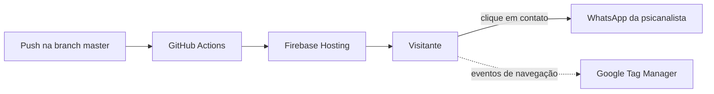

# Site da Psicanalista Anabel

Site institucional de uma psicanalista com atendimentos no Rio de Janeiro, em Niterói e online. O objetivo do site é transformar visitantes em pacientes: apresentar a profissional, gerar identificação com as questões que ela atende e levar a pessoa a iniciar uma conversa pelo WhatsApp.

<!-- TODO: adicionar o link do site publicado e um print da página inicial -->


## Contexto e problema

Profissionais de saúde mental que atendem de forma autônoma dependem de indicação e de redes sociais para conseguir pacientes. Sem um site próprio, quem pesquisa no Google não encontra a profissional, e quem chega por indicação não tem onde conhecer o trabalho dela antes de entrar em contato.

O site resolve isso com uma página única, rápida no celular, que responde às dúvidas mais comuns sobre psicanálise e coloca o contato pelo WhatsApp a um clique em qualquer ponto da página.

## Público e stakeholders

| Perfil | Necessidade | Como o site atende |
| --- | --- | --- |
| Pessoa buscando terapia | Entender se a psicanálise ajuda no que ela sente e confiar na profissional | Seções de queixas comuns, benefícios, depoimentos, vídeo de apresentação e perguntas frequentes |
| Psicanalista (cliente) | Receber contatos qualificados e ser encontrada no Google | Botões de WhatsApp com mensagem pronta, SEO básico e medição com Google Tag Manager |
| Desenvolvedor (manutenção) | Publicar mudanças sem trabalho manual | Deploy automático no Firebase a cada push na `master` |

## Funcionalidades

- **Banner principal** com chamada para agendamento e foto da profissional, com versões de imagem para celular e computador.
- **Carrossel de benefícios** ("Se entender melhor", "Recuperar o poder de escolha" e outros), navegável por setas e indicadores.
- **Sobre mim** com vídeo do YouTube carregado sob demanda (`lite-youtube`), para não pesar no carregamento inicial.
- **Queixas comuns**: solidão, ansiedade, depressão, autossabotagem, luto e outras, para o visitante se reconhecer.
- **Depoimentos de pacientes** e **perguntas frequentes** em formato sanfona.
- **Tipos de atendimento**: online e presencial.
- **Botão flutuante de WhatsApp** e botões de contato que abrem a conversa com mensagem pré-preenchida.
- **Menu responsivo** (hambúrguer no celular) e página 404 personalizada.

## Requisitos

### Funcionais

| Código | Requisito |
| --- | --- |
| RF01 | O visitante deve conseguir iniciar uma conversa no WhatsApp a partir de qualquer seção da página. |
| RF02 | O site deve apresentar a profissional, sua abordagem e as modalidades de atendimento (online e presencial). |
| RF03 | O site deve responder às dúvidas mais frequentes sobre psicanálise. |
| RF04 | O site deve exibir depoimentos de pacientes. |

### Não funcionais

| Código | Requisito | Como foi atendido |
| --- | --- | --- |
| RNF01 | Carregar rápido em conexões móveis | Imagens convertidas para WebP e comprimidas, CSS crítico no `<head>`, `loading="lazy"` e vídeo com carregamento sob demanda |
| RNF02 | Funcionar bem em qualquer tamanho de tela | Layout responsivo e imagens específicas para celular |
| RNF03 | Permitir medir de onde vêm os contatos | Google Tag Manager instalado no `<head>` e no `<body>` |
| RNF04 | Custo de hospedagem próximo de zero | Site estático no plano gratuito do Firebase Hosting |

## Arquitetura e publicação

O site é estático: não tem backend nem banco de dados. Todo o conteúdo está em um único `index.html`, e a publicação é automática.



- `firebase-hosting-merge.yml`: publica em produção a cada push na `master`.
- `firebase-hosting-pull-request.yml`: gera um link de pré-visualização para cada pull request.

## Como rodar localmente

Não há dependências para instalar. Basta servir a pasta com qualquer servidor estático:

```bash
git clone https://github.com/vaz-lucas/anabel-therapist-site.git
cd anabel-therapist-site
npx serve .
```

Para publicar manualmente (normalmente não é necessário, por causa do deploy automático):

```bash
npm install -g firebase-tools
firebase login
firebase deploy --only hosting
```

## Estrutura de pastas

```text
.
├── index.html            # página única com todas as seções
├── style.css             # estilos globais e responsividade
├── script.js             # menu responsivo, FAQ e interações
├── component/            # carrossel de benefícios (JS + CSS)
├── yt/                   # lite-youtube, para carregar o vídeo só quando clicado
├── images/               # imagens WebP e ícones SVG
├── 404.html              # página de erro personalizada
├── firebase.json         # configuração do Firebase Hosting
└── .github/workflows/    # deploy automático (produção e pré-visualização)
```

## Decisões

| Decisão | Alternativas consideradas | Por quê |
| --- | --- | --- |
| HTML, CSS e JavaScript puros | React, WordPress | Uma página de conteúdo não precisa de framework; fica mais leve, rápida e sem manutenção de dependências. |
| WhatsApp como único canal de contato | Formulário, agenda online | É o canal que o público já usa e que a profissional responde; elimina etapas até o primeiro contato. |
| Firebase Hosting com deploy pelo GitHub Actions | Netlify, Vercel, hospedagem compartilhada | Gratuito, com HTTPS e pré-visualização por pull request. |
| Imagens em WebP e versões por dispositivo | Imagens originais | Reduz o peso da página no celular, onde está a maior parte do público. |

## Processo de desenvolvimento

O trabalho foi feito em uma branch `dev`, com merges na `master` a cada entrega validada com a cliente. As principais etapas foram: primeira versão com contato pelo WhatsApp (abril de 2025), seções de tipos de atendimento, queixas, depoimentos e FAQ (maio e junho de 2025), novo carrossel e otimização de imagens (julho de 2025) e deploy automático (julho de 2026).

## Próximos passos

- Medir os cliques nos botões de WhatsApp como conversão no Google Tag Manager.
- Adicionar meta tags de descrição e Open Graph para melhorar a prévia em buscadores e no WhatsApp.
- Revisar acessibilidade (textos alternativos das imagens e contraste) com o Lighthouse.

## Autor

Desenvolvido por [Lucas Vaz](https://github.com/vaz-lucas).
