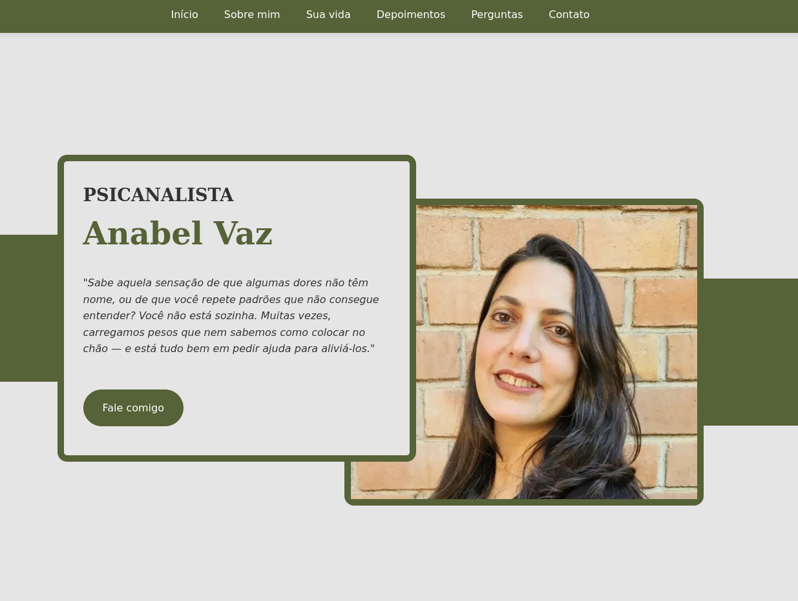

# Site da Psicanalista Anabel

Site que apresenta uma psicanalista com atendimento no Rio de Janeiro, em Niterói e online, e leva quem procura terapia direto a uma conversa no WhatsApp.

**Site:** [anabelterapeuta.com](https://anabelterapeuta.com/)

## Contexto

A psicanalista não queria ser influencer ou depender apenas do boca a boca para conseguir clientes, gostaria de focar em seus atendimentos e formações.

O site resolve isso com uma página rápida e de baixo custo, que responde às dúvidas mais comuns sobre psicanálise e coloca o WhatsApp a um toque em qualquer parte da página.

## Público

| Quem                    | O que precisa                                                          | Como o site atende                                                                    |
| ----------------------- | ---------------------------------------------------------------------- | ------------------------------------------------------------------------------------- |
| Pessoa buscando terapia | Entender se a psicanálise ajuda no que sente e confiar na profissional | Queixas comuns, benefícios, depoimentos, vídeo de apresentação e perguntas frequentes |
| Psicanalista            | Receber contatos e ser encontrada no Google                            | Botões de WhatsApp com mensagem pronta e medição com Google Tag Manager               |

## O que o site faz

| Funcionalidade                                                               | Status |
| ---------------------------------------------------------------------------- | ------ |
| Botão flutuante e botões de contato que abrem o WhatsApp com mensagem pronta | Pronto |
| Seções de benefícios, queixas comuns, depoimentos e perguntas frequentes     | Pronto |
| Vídeo de apresentação que só carrega quando a pessoa toca nele               | Pronto |
| Atendimento online e presencial explicados                                   | Pronto |
| Medir os cliques no WhatsApp como conversão                                  | Pronto |

## Como funciona por dentro

O site é uma página estática em HTML, CSS e JavaScript, sem framework e sem banco de dados. Ele fica hospedado no Firebase Hosting, e cada push na branch master publica uma nova versão pelo GitHub Actions. Cada pull request ganha um link de pré-visualização antes de ir ao ar.

## Requisitos não funcionais

| Requisito                                  | Como foi atendido                                                                                                    |
| ------------------------------------------ | -------------------------------------------------------------------------------------------------------------------- |
| Carregar em até 3 segundos numa conexão 4G | Imagens em WebP e comprimidas, CSS principal no cabeçalho da página, imagens e vídeo carregados só quando necessário |
| Funcionar bem em qualquer tamanho de tela  | Layout responsivo e imagens próprias para celular                                                                    |
| Custo de hospedagem perto de zero          | Plano gratuito do Firebase Hosting                                                                                   |

## Decisões

| Decisão                                    | Alternativas                      | Por quê                                                                                                                                           |
| ------------------------------------------ | --------------------------------- | ------------------------------------------------------------------------------------------------------------------------------------------------- |
| HTML, CSS e JavaScript puros               | WordPress, React                  | Uma página de conteúdo não precisa de framework: fica mais leve e sem dependências para atualizar. Em troca, a cliente não edita o texto sozinha. |
| WhatsApp como único canal de contato       | Formulário, agenda online         | É o canal que o público já usa e que a profissional responde; tira etapas até o primeiro contato.                                                 |
| Firebase Hosting com publicação automática | Netlify, hospedagem compartilhada | Gratuito, com HTTPS e pré-visualização por pull request.                                                                                          |

## Autor

Desenvolvido por [Lucas Vaz](https://github.com/vaz-lucas).
